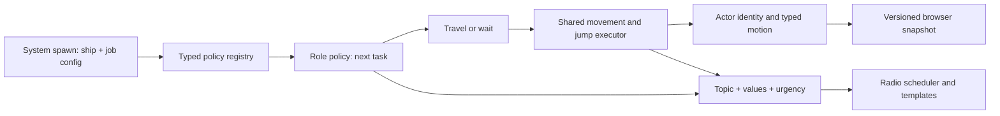

# Adding NPC roles

NPC purpose is a registered policy, not a ship subclass or another branch in the traffic controller. NPC culture, hull design, faction, livery and job can be chosen independently. See [CULTURES.md](CULTURES.md) for identity defaults and persistence. The legacy `Ship.role` flag only supplies fallback AI for unmanaged ships; managed behavior belongs in `actor.job`.

## Runtime boundaries



- `JobPolicy<Config, State>` validates role-specific config/state and chooses a next task. Implementations live under `src/game/traffic/jobs/`.
- `TrafficJobs` registers policies and binds their concrete types. Type erasure is confined to its adapter; persisted JSON is decoded by the relevant policy before use.
- `TrafficDirector` owns identity, retirement, membership, interruptions and orchestration. It contains no checks for individual job kinds.
- `TrafficNavigation` executes local flight, multi-hop system journeys and waits. Active ships use physical steering; unobserved ships use scheduled progress through the same motion states.
- `RadioDirector` schedules facts. `RadioTemplates` supplies topic formatters. Neither changes a job.

## Use an existing role

Add a spawn to a system's `traffic` array. For example, another police patrol in Kepler:

```ts
{
  ship: {
    ...makeShip('marshal-eight', 'Marshal Eight', 'cutter', 'authority', -500, 150),
    factionId: 'police',
    livery: 'police'
  },
  job: {
    kind: 'patrol',
    config: {
      holdSeconds: 5,
      responseRange: 1100,
      waypoints: [
        { kind: 'station', systemId: 'kepler', stationId: 'relay' },
        {
          kind: 'point', systemId: 'kepler',
          position: position(-900, -240), label: 'Jump corridor'
        }
      ]
    }
  }
}
```

Use a globally unique ship ID. Existing saved identities are retained; newly authored IDs are added once when a voyage loads. Captured/destroyed actors are not respawned. Changing an existing definition does not normally overwrite that actor's saved job config/state. Explicit content migrations may upgrade known stock purposes while retaining their current motion and delivery.

Built-ins:

| Kind | Configuration | Behavior |
| --- | --- | --- |
| `freight` | Two-port `route`, `quantity`, loading/unloading seconds | Assigned stations, real commodity manifest, repeating deliveries |
| `long-haul` | Market `home`, quantity/times, preferred `minHops` | Roaming deliveries across the reachable universe |
| `passenger` | Two-port `route`, `passengers`, boarding/layover seconds | Boards, travels, disembarks, returns |
| `liner` | `routing: "roaming"`, home, tour length, preferred min hops; or authored `stops` | Multi-system tours with home returns, or an explicit circuit |
| `patrol` | Local `waypoints`, hold seconds, response range | Surveys a circuit and responds to reported aggression |

Routes may connect two different stations in one system or ports reachable through the system graph. The job keeps its final port while the executor handles intermediate hops. Patrol circuits remain local; liner circuits can span reachable systems. Passenger counts are separate from commodity cargo and do not debit markets.

## New-game prehistory

Normal free roam advances NPC background schedules for 300 game seconds before the player takes control. It uses five bounded 60-second updates, then rematerializes only the ships currently present in Ashen. Jobs, cargo, gateway journeys, identity and destination memory evolve normally; there is no random position scattering. The session clock starts at 300 seconds so all deadlines remain consistent. Player state, credits and market stocks retain the normal start values. Historical announcements are discarded.

Loading/importing a save restores its own timeline without a warm-up. The raid and guided trading fixtures deliberately start at time zero. `startFreeRoam` accepts `{ trafficWarmup: false }` for deterministic tests needing the original spawn state. This startup prehistory does not add wall-clock/offline progression.

## Destination planning

Assigned `freight` jobs keep their two authored ports. `long-haul` jobs choose a market station after each completed delivery, treating the arrival port as their next origin. They prefer compatible exports and at least two jumps when available. Open ports without compatible exports permit an empty repositioning trip. This is a purposeful traffic model, not a freight-contract or market-equilibrium simulation.

Roaming liners choose real stations or planet viewpoints in other systems. `tourLength` counts sightseeing stops (default four); then they travel to their home station to exchange guests. Existing `stops` configurations remain explicit circuits, including local tours. `routing: "circuit"` is optional for older definitions.

The shared [destination selector](src/game/traffic/destinations.ts) filters candidates through the **same access policy** as navigation. It avoids the current system, prefers systems outside recent history when available, then prefers the requested hop distance. Selection is weighted by bounded hop count, first by system and then by destination, so systems with many stations do not automatically dominate. Small or restricted networks fall back to shorter/repeated trips; no reachable destination means a retry wait without consuming a decision.

Each draw is keyed by home-system seed, stable ship ID and a saved decision counter. The selected destination, counter and last three selected systems are explicit serialized state. Contact inspection and reload do not draw randomness. Intermediate jumps, interruptions and blocked routes retain the committed destination. A reopened route resumes that delivery; only the next completed stop triggers new planning. Newly registered systems enter future decisions without rebuilding existing itineraries. Routing itself still uses the fewest allowed jumps.

Decisions run at task boundaries, not every frame: one graph traversal plus candidate enumeration/ranking per stop. No worker or new persistence backend is required. Destination choice is reproducible for the same state and catalog; editing the catalog or access policy can change future choices.

Content revision five converts three stock freighters (Aster Cradle, Nacre and Meridian) and the two stock liners without adding more actors. Old freight legs keep their origin, destination, cargo and motion until unloading completes; liners finish a currently committed old stop. Captured/destroyed actors remain historical. Current saves retain their jobs unchanged.

## Add a new family

1. Define its `Config` and `State`, then implement `JobPolicy<Config, State>`.
2. Implement `readConfig` and `readState` for content/save validation. Use shared destination/route/count validators where appropriate. Keep config/state JSON-serializable; a future incompatible policy-state change needs migration.
3. `create` supplies initial state. `next` is called initially and after each task completes; it returns the next state and task, plus optional announcement and completed-journey flag. It is not called every frame. In current policies, saved `next` means the stage to schedule when the running task finishes.
4. `describe` supplies contact title, purpose and manifest. Optional `onAggression` and `order` hooks support reactions such as police interception. `combatPosture` selects shared broadside defense or evasion; passenger and leisure policies evade, while freight/patrol policies use broadsides. Frequent order queries should be cheap and free of state mutation.
5. Register the policy in `createTrafficJobs`, then author spawns. Custom session construction/load can also receive an explicitly configured registry.
6. Register any new shared radio topics with `RadioTemplates`; culture profiles may override topics with data-driven phrases. Policies should continue emitting facts without choosing a culture or wording. Unknown topics produce no bubble and do not affect simulation.

The test-only survey role in `src/traffic-extension.test.ts` demonstrates a new family running, speaking, saving and restoring without edits to the controller, navigation, core simulation or generic save decoder.

## State and interruption rules

A discriminated motion union requires a leg for flight and arrival-system/gate information for transit. Waiting has a wait action; travelling has a destination. Interrupted/disabled states carry a valid local continuation. The executor rebases flight from the actual position when resuming and shifts wait/charging deadlines by the interrupted duration. Capture/destruction retires the job permanently.

Save schema 6 stores explicit egress gate/connection IDs and plotted player destinations along with policy kind/config/state plus motion, NPC/captain cultures and ship designs. Versions 1–5 migrate on load. Missing policies or invalid state fail validation; the browser UI preserves an unreadable save rather than inventing a replacement NPC.

## Scope of the extension seam

New roles using travel, waits, manifests and reactions need a policy, content and optional dialogue. A new physical capability—towing, formation constraints, mining beams—may require another execution primitive or simulation component. That is an explicit capability extension, not something a generic job registry can supply automatically. Shared multi-hop routing is implemented; weighted route costs, docking congestion, player passenger contracts and general crime/reputation systems remain outside this slice. See [SYSTEM_AUTHORING.md](SYSTEM_AUTHORING.md).
